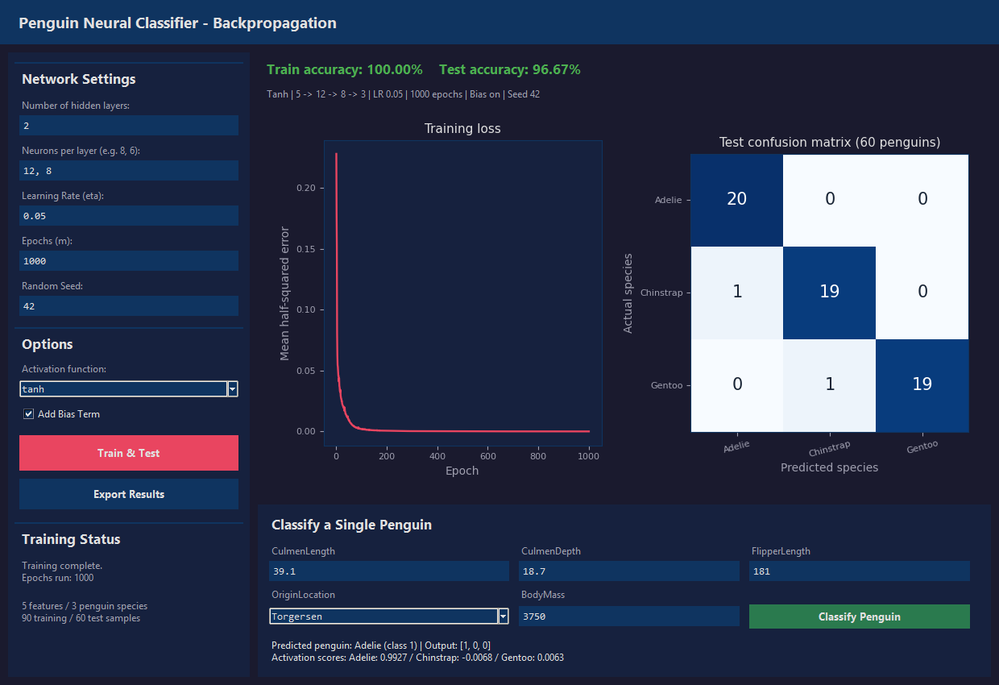

# Neural Networks - Task 2

Penguin classification using backpropagation

## 1. Introduction

The aim of this task was to classify three penguin species using a multilayer neural network trained with backpropagation. Sigmoid and tanh were compared using the same dataset. The network uses five input features and three output neurons, with one output for each species.

## 2. Dataset and experiment setup

The dataset contains 50 samples for each of Adelie, Chinstrap and Gentoo. The first 30 samples of each species were used for training and the remaining 20 for testing, giving 90 training samples and 60 test samples. Missing numerical values were filled using training-set means, and all features were standardized using training-set statistics. OriginLocation was encoded as Biscoe = 0, Dream = 1 and Torgersen = 2.

A total of 48 configurations were tried, using 1, 2, 3, 4, 5 hidden layers. The learning rates were 0.01, 0.05, and the epoch counts were 600, 1000. Weights and enabled biases were initialized with small random values between -0.1 and 0.1.

To compare the settings, 24 of the 30 training samples per species were used to fit each network and the other 6 were used for validation. Preprocessing was fitted on those 72 training samples. The configuration with the highest validation accuracy was selected for each activation; lower validation loss was used to break ties. Each selected network was then retrained on all 90 training samples before testing on the remaining 60.

## 3. Results

| Activation | Train accuracy | Test accuracy | LR | Epochs | Hidden layers | Neurons per layer | Bias | Seed |
| --- | --- | --- | --- | --- | --- | --- | --- | --- |
| Sigmoid | 98.89% | 98.33% | 0.01 | 600 | 1 | 12 | On | 42 |
| Tanh | 100.00% | 96.67% | 0.05 | 1000 | 2 | 12, 8 | On | 42 |

The sigmoid network classified 59 out of 60 test samples correctly (98.33%).
The tanh network classified 58 out of 60 test samples correctly (96.67%).

## 4. Effect of the number of hidden layers

These are validation results (18 samples), not final test results.

| Activation | Hidden layers | Neurons per layer | LR | Epochs | Validation accuracy | Validation loss |
| --- | --- | --- | --- | --- | --- | --- |
| Sigmoid | 1 | 12 | 0.01 | 600 | 88.89% | 0.06973 |
| Sigmoid | 2 | 12, 8 | 0.01 | 1000 | 88.89% | 0.14173 |
| Sigmoid | 3 | 8, 8, 5 | 0.01 | 1000 | 33.33% | 0.33333 |
| Sigmoid | 4 | 8, 8, 5, 3 | 0.01 | 1000 | 33.33% | 0.33333 |
| Sigmoid | 5 | 12, 10, 8, 6, 4 | 0.01 | 1000 | 33.33% | 0.33333 |
| Tanh | 1 | 12 | 0.01 | 600 | 88.89% | 0.10838 |
| Tanh | 2 | 12, 8 | 0.05 | 1000 | 88.89% | 0.08668 |
| Tanh | 3 | 8, 8, 5 | 0.05 | 1000 | 88.89% | 0.10197 |
| Tanh | 4 | 8, 8, 5, 3 | 0.01 | 1000 | 88.89% | 0.10964 |
| Tanh | 5 | 12, 10, 8, 6, 4 | 0.05 | 1000 | 83.33% | 0.13453 |

### Discussion

The table shows that increasing the number of hidden layers did not consistently improve validation accuracy. Several configurations gave the same accuracy, so validation loss helped choose between them. These results apply to the settings tested here; changing the initialization, learning rate or number of epochs could change how the deeper networks learn. The selected numbers of hidden layers were 1 for sigmoid and 2 for tanh.

## Sigmoid

Rows: actual species. Columns: predicted species. Order: Adelie, Chinstrap, Gentoo.

```text
[20, 0, 0]
[1, 19, 0]
[0, 0, 20]
```


## Tanh

Rows: actual species. Columns: predicted species. Order: Adelie, Chinstrap, Gentoo.

```text
[20, 0, 0]
[1, 19, 0]
[0, 1, 19]
```



